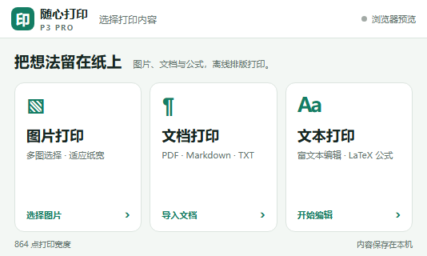

# 随心打印 · P3 Pro AnyPrint

在喵喵机 P3 Pro 自带安卓系统上打印图片、PDF、Markdown 和富文本，按 534×320 横屏小屏设计。文档、公式与字体资源离线运行。



## 功能

- **图片打印** — 多图勾选、排序，等比例适应 864 点纸宽，透明背景转白底。
- **文档打印** — PDF 逐页转图，支持页码范围。Markdown 支持标题、列表、表格、代码块和 LaTeX。TXT 支持 UTF-8、带 BOM 的 UTF-16 与 GB18030。
- **文本打印** — Quill 富文本编辑，单行与跨行选区左对齐、居中、右对齐。富文本与 Markdown 分别保存草稿。
- **公式排版** — 离线 KaTeX，支持 `$...$`、`$$...$$`、`\(...\)`、`\[...\]` 和跨行的 `\[...\]`。
- **打印连接** — 优先调用 P3 Pro 的 `mbprint` 系统服务，提供 Wi-Fi 与 4G 版的原生串口模式。诊断可复制或导出。

JPEG、PNG、WebP、BMP、GIF、TIFF 和 SVG 已完成导入或转换检查。GIF 与多页 TIFF 使用首帧或首页。HEIF、HEIC、AVIF 的解码能力取决于设备系统。

## 使用与实机状态

维护者于 2026-11-14 反馈 **1.0.1 已在 P3 Pro 实机使用成功**。此前照片确认的设备为 Android 8.1.0，具有 `mbprint` 服务和 `/dev/ttyMT0` 串口。该反馈未逐项覆盖全部文件类型、4G 分支和长时间连续打印。

原生串口测试前，在 P30ProSettingTool 中点击“断开”，再进入本应用打印。该工具切到后台后仍可能持有串口。

详细操作见 [使用说明](delivery/使用说明.md)，协议字段、CRC 和 Binder 接口见 [打印协议研究](delivery/打印协议研究.md)。

## 构建

本项目使用 PowerShell、Android SDK 构建工具和 Java 编译器打包。推荐 Windows、PowerShell 7、JDK 21、Node.js 22，安装 Android SDK Platform 33 与 Build Tools 36.0.0。

应用依赖 P3ProPrint 的原厂图片与串口 JNI 库。准备本地 P3ProPrint 3.4.0 APK 后运行提取脚本，参见 [第三方组件说明](THIRD_PARTY_NOTICES.md)。

```powershell
git clone https://github.com/passionsugar/p3pro-anyprint.git
Set-Location p3pro-anyprint

# 使用本机 SDK 与 JDK 的实际安装路径。
$env:ANDROID_HOME = 'D:\Android\Sdk'
$env:JAVA_HOME = 'C:\Program Files\Java\jdk-21'

# 下载缓存和临时文件放在当前项目目录。
New-Item -ItemType Directory -Path tools\temp -Force | Out-Null
$env:npm_config_cache = Join-Path $PWD 'tools\npm-cache'
$env:TEMP = Join-Path $PWD 'tools\temp'
$env:TMP = $env:TEMP

npm.cmd ci --no-audit --no-fund
npm.cmd run vendor
.\scripts\extract-native.ps1 -Apk 'D:\Downloads\P3ProPrint.apk'
.\build.ps1
```

构建输出为 `delivery/P3Pro-AnyPrint-1.0.1.apk`。首次构建在 `build/signing/local.keystore` 创建本地签名，用同一密钥构建的后续版本可覆盖安装。自建 APK 的签名由构建者管理。

## 检查

```powershell
npm.cmd test
.\scripts\test-protocol.ps1
npm.cmd run preview
```

浏览器预览地址为 `http://127.0.0.1:4173`。浏览器中的打印操作需要 APK 的原生接口。

界面自动检查需要 Playwright 浏览器，可将下载目录设在项目内。在预览服务运行时执行下面的命令。

```powershell
$env:PLAYWRIGHT_BROWSERS_PATH = Join-Path $PWD 'tools\playwright'
$env:PLAYWRIGHT_SKIP_BROWSER_GC = '1'
npx.cmd playwright install chromium
node .\scripts\test-ui.cjs
```

原生仪器测试使用已启动的 Android 模拟器。先安装本机构建的 APK，再执行 `scripts/test-android.ps1 -Device emulator-5580`。可参考 `scripts/start-test-emulator.ps1` 创建并启动项目内 AVD，系统镜像需要预先安装。

当前记录包括 36 项 Android 9 原生检查、5 项内容渲染检查、52 组实机照片状态包拆分检查，以及 534×320、534×230 的界面检查。原 APK 的 72 组封包对照可通过 `test-protocol.ps1 -CompareOriginal` 重现，前提是本地具有对应的 JADX 输出。参见 [原生结果](qa/android-results.json)、[界面结果](qa/ui-results.json) 与 [协议结果](qa/protocol-results.txt)。

## 许可证

项目原创代码与文档使用 [MIT 许可证](LICENSE)。网页依赖及原厂 JNI 库的许可范围见 [THIRD_PARTY_NOTICES.md](THIRD_PARTY_NOTICES.md)。
